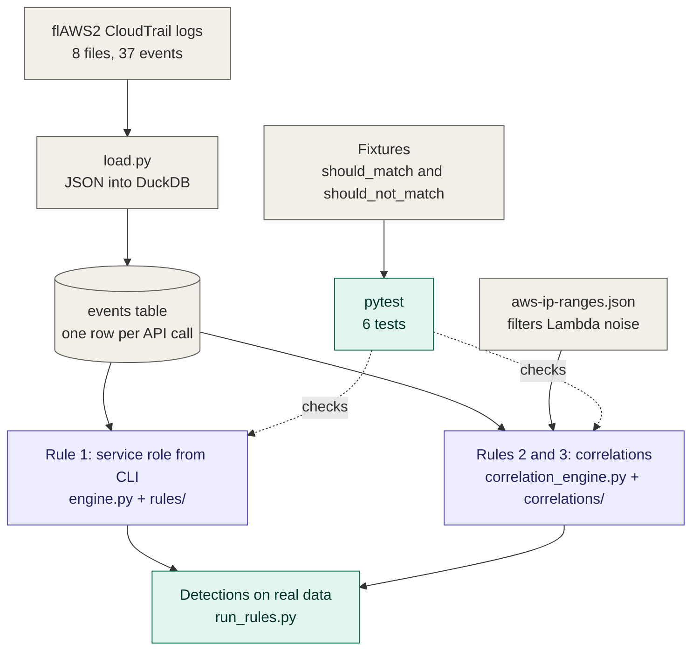

# Detection-as-Code: Finding a Cloud Attack in CloudTrail Logs

A small, tested detection pipeline that finds a real attacker's path through AWS CloudTrail logs. It needs no AWS account: everything runs locally on public attack data.

**What it does:** loads CloudTrail logs into DuckDB, runs three detection rules against them (one single-event rule and two correlation rules), and checks every rule with automated tests on known-good and known-bad events.

**Why I built it:** most beginner cloud security projects are about building defenses. Detection engineering, deciding what an attack looks like in logs and writing rules to catch it, is a separate skill and a real job. I wanted to learn how attackers behave in AWS, and to practice measuring whether a rule is any good instead of just writing one.

## Architecture



**How to read it:** logs go into DuckDB once. Two engines run the rules against that table, and `run_rules.py` prints the detections. The test layer runs the same engines against small hand-made fixtures, so every rule is checked on events that should and should not trigger it.

---

## Contents

- [The data](#the-data)
- [Results at a glance](#results-at-a-glance)
- [How I did it, step by step](#how-i-did-it-step-by-step)
- [The three rules](#the-three-rules)
- [How the rules improved (and why)](#how-the-rules-improved-and-why)
- [Problems I hit and how I solved them](#problems-i-hit-and-how-i-solved-them)
- [Limitations](#limitations)
- [Run it yourself](#run-it-yourself)
- [Project layout](#project-layout)
- [What I'd do next](#what-id-do-next)
- [Credits](#credits)

---

## The data

I used the public CloudTrail logs from [flAWS2.cloud](http://flaws2.cloud/), a security challenge by Scott Piper (Summit Route). The logs record a real walkthrough of an attack on a deliberately vulnerable AWS environment.

- **8 log files, 37 events** in total. Small enough to read by hand, which is why it works well for learning.
- Normal platform activity (Lambda, ECS, API Gateway) is mixed in with the attacker's actions, so the rules have to tell them apart.

## Results at a glance

| Rule | Type | Hits | Real attacker events | Catches |
|---|---|---|---|---|
| 1. Service role used from CLI | Single event | 5 | 5 | level1 and level3 compromise |
| 2. Role session used from multiple IPs | Correlation | 1 | 1 | level1 compromise only |
| 3. Service session used from public non-AWS IP | Correlation | 5 | 5 | level1 and level3 compromise |

All 6 automated tests pass (each rule has one test that must fire and one that must stay quiet).

Rule 3 went through three versions: **11 hits with about 45% precision**, then **10 hits** after fixing a bug, then **5 hits with 100% precision** on this dataset after adding an AWS-IP filter. The story of each change is below.

---

## How I did it, step by step

### 1. Got the data without an AWS account

The flaws2 logs sit in a public S3 bucket, so they can be downloaded without credentials (`--no-sign-request`). My AWS CLI was pointed at LocalStack, so I overrode the endpoint for this download:

```powershell
aws s3 sync s3://flaws2-logs/ . --no-sign-request --endpoint-url https://s3.amazonaws.com --region us-east-1
```

### 2. Read one event by hand before writing any code

I decompressed one file in Python and read a single record field by field: `eventName` (what happened), `eventSource` (which service), `userIdentity` (who), `sourceIPAddress` (from where), `errorCode` (did it fail).

The first record turned out to be **not** the attacker. It was `ecs-tasks.amazonaws.com` assuming the `level3` role, which is the platform doing its normal job. Learning to tell "AWS acting as itself" from "a human using AWS" is most of the work in this project.

### 3. Loaded everything into DuckDB

DuckDB can query JSON directly, so no database server was needed. Each CloudTrail record became one row:

```sql
CREATE TABLE events AS
SELECT unnest(Records) AS r
FROM read_json('data/AWSLogs/**/*.json.gz', union_by_name=true, maximum_object_size=104857600)
```

Result: **37 events**. The most common event names were `GetObject` (22), `CreateLogStream` (5), `AssumeRole` (3), `Invoke` (2), then one each of `ListBuckets`, `ListObjects`, `ListImages`, `BatchGetImage` and `GetDownloadUrlForLayer`. The rare events were the interesting ones: the container-registry and bucket-listing calls looked like someone exploring.

### 4. Built a timeline and found the attacker

Sorting all events by time (in UTC) separated two kinds of activity:

- **Platform noise:** identity type `AWSService`, with a service name like `lambda.amazonaws.com` in the IP field.
- **A human:** one IP address, `104.102.221.250`, using both a browser (the challenge website) and the `aws-cli` on macOS.

The attacker's path, reconstructed from the log:

1. `ListObjects` using the `level1` role (looking around a bucket)
2. `ListImages`, `BatchGetImage`, `GetDownloadUrlForLayer` using the same role (finding and pulling a container image)
3. `ListBuckets` using the `level3` role, with a session name that matched the one the ECS service had been issued earlier (credentials taken out of a running container)

### 5. Turned what I saw into rules, and tested each one

For every rule I wrote a YAML definition, then a `should_match.json` fixture (events that must trigger it) and a `should_not_match.json` fixture (events that must not). Then I broke each rule on purpose to check that its test actually failed.

---

## The three rules

### Rule 1: Service role credentials used from a CLI

**File:** `rules/service_role_used_from_cli.yml`

Roles meant for AWS services (here `level1` and `level3`) should not be used with an `aws-cli` or `botocore` user agent. If they are, someone probably has the credentials.

**Why it's weak:** it depends on the user agent, which the attacker controls. One flag changes it, and the rule goes blind. That weakness led to rule 3.

**Detail that mattered:** the same CLI user agent appears with square brackets in some events (`[aws-cli/...]`) and without in others, depending on which service logged the event. An exact-match rule would miss half of them, so the rule uses substring matching.

### Rule 2: One role session used from two different IPs

**File:** `correlations/role_session_multiple_ips.yml`

If the same assumed-role identity makes calls from two different public IPs within an hour, the credentials may have been copied somewhere else.

**What it found:** `level1/level1` used from `34.234.236.212` (Lambda) and `104.102.221.250` (the attacker).

**What it missed:** the `level3` compromise. The legitimate use of that session was the ECS service itself, which CloudTrail logs with a service name instead of an IP. My filter removes non-IP values (otherwise a hostname like `ecs-tasks.amazonaws.com` would count as a "second IP" and fire constantly), so rule 2 had nothing to compare against.

### Rule 3: Service-issued session used from a public IP outside AWS

**File:** `correlations/service_session_used_from_public_ip.yml`

When an AWS service assumes a role, CloudTrail logs the `roleSessionName`. If an API call using that same session later comes from a public IP that is **not** inside Amazon's address space, the credentials have left the service.

**Why it's stronger:** it doesn't depend on a user agent. The attacker doesn't control the session name or the fact that AWS issued the credentials to a service. It catches `level3`, which rule 2 missed.

---

## How the rules improved (and why)

Rule 3 is the best example of the process, because the first version was noisy.

### Version 1: 11 hits, about 45% precision

Reading the output line by line, I sorted the 11 hits:

| Hits | What it was | Verdict |
|---|---|---|
| 5 | `level1` session from `34.234.236.212`, all `CreateLogStream` | False positive: Lambda writing its own logs |
| 4 | `level1` from `104.102.221.250`: list/pull container image | True positive |
| 1 | `level3` session from `104.102.221.250`: `ListBuckets` | True positive |
| 1 | The same `ListBuckets` event, repeated under `ecsTaskExecutionRole` | Duplicate caused by a bug |

### Version 2: 10 hits, fixed a join bug

The ECS service had assumed **two** roles (`level3` and `ecsTaskExecutionRole`) using the **same session name**. My join matched on session name alone, so one attacker event matched both.

**Fix:** require the full ARN to match (account, role name and session name), not just the session name.

**Why this matters:** a fix without a test can quietly come back. I added a regression case: the same session name used under a different role must not match.

### Version 3: 5 hits, 100% precision on this dataset

The five Lambda hits were technically correct by the rule's logic (a service session used from a public IP) but were normal behavior, since Lambda always runs from public Amazon addresses. I considered three options:

1. **Allowlist the one Lambda IP.** Works in the lab, useless in practice because Lambda uses thousands of rotating addresses.
2. **Exclude the `awslambda-worker` user agent.** Repeats rule 1's weakness: the attacker controls that field.
3. **Ignore IPs inside Amazon's published ranges.** The real signal is a service credential being used from *outside* AWS.

I chose option 3, using AWS's official `ip-ranges.json`. The attacker's `104.102.221.250` is outside Amazon's space and Lambda's `34.234.236.212` is inside, so the filter removes exactly the noise and keeps the attack.

**A test that guards the filter:** I added a fixture where a service session is used from an Amazon IP. Only the filter can make that test pass, so removing the filter makes the test fail. (Without that case, someone could delete the filter and every test would still pass.)

---

## Problems I hit and how I solved them

| Problem | Cause | Fix |
|---|---|---|
| `Could not connect to the endpoint URL: localhost:4566` | My AWS CLI was configured to use LocalStack | Added `--endpoint-url https://s3.amazonaws.com --region us-east-1` to the command |
| Hundreds of "Skipping file... not readable" warnings | I ran `aws s3 sync` from my home folder, so it scanned my whole user profile | Created a dedicated project folder and ran downloads from `data/` |
| `Required module 'pytz' failed to import` | DuckDB needs `pytz` to return timestamp values to Python | `pip install pytz` |
| Timestamps 2 hours off | Python converted UTC to my local timezone (SAST) | `SET TimeZone='UTC'`. Detection work uses UTC. |
| A test failed when I tried to "break" a rule | My instruction changed one of two matching terms; the other term still matched | Re-checked the rule text, restored it, and used a more reliable break (an invalid identity type) |
| `IndentationError` after editing the engine | Pasted code with mismatched indentation | Replaced the whole file with a clean copy instead of patching lines |
| Filter had no effect (still 10 hits) | The `exclude_aws_ip_ranges` line was missing from the rule file | Replaced the whole rule file, then confirmed 5 hits |

---

## Limitations

I'd rather state these than have a reviewer find them.

- **The dataset is tiny (37 events).** The rules work on it, but I can't claim a real false-positive rate. Measuring that needs a large normal-activity dataset. The 100% precision figure is for this lab data only.
- **Rule 1 depends on a field the attacker controls** (the user agent). It's a watchlist rule with hardcoded role names (`level1`, `level3`), which fits this lab but would need a maintained list of service-only roles in real use.
- **Rule 3 misses attackers who use the stolen credentials from inside AWS**, for example from their own EC2 instance, because their IP falls in Amazon's ranges. Rules 1 and 2 might still catch them. That's why the rules are layered.
- **Rule 2 misses sessions used from only one IP**, as the `level3` case shows.
- **The correlation rules use my own YAML format, and the rule runner supports only a subset of Sigma.** Rule 1 follows Sigma conventions, but this repo isn't a full Sigma implementation.
- **Credentials appear in plain text in the logs.** The `AssumeRole` record includes a temporary access key and session token in `responseElements`. These are long-expired credentials from a 2018 challenge, but in a real environment, anyone with read access to the logs could use live ones. Log access needs to be tightly controlled.

---

## Run it yourself

Tested on Windows with PowerShell and Python 3.13.

```powershell
# 1. Install dependencies
pip install duckdb pyyaml pytest pytz

# 2. Download the logs (run from the data folder)
mkdir data
cd data
aws s3 sync s3://flaws2-logs/ . --no-sign-request --endpoint-url https://s3.amazonaws.com --region us-east-1
Invoke-WebRequest https://ip-ranges.amazonaws.com/ip-ranges.json -OutFile aws-ip-ranges.json
cd ..

# 3. Load the logs into DuckDB
python load.py

# 4. Run the rules against the real data
python run_rules.py

# 5. Run the tests
python -m pytest -v
```

If your AWS CLI isn't pointed at LocalStack, you can drop the `--endpoint-url` flag. The `data/` folder and `flaws2.duckdb` are not committed (the logs are large, and the AWS IP ranges file changes regularly).

## Project layout

```
detection-as-code/
├── rules/                  # single-event rules (Sigma-style YAML)
├── correlations/           # correlation rules (custom YAML)
├── tests/
│   ├── fixtures/           # should_match / should_not_match JSON per rule
│   ├── test_rules.py
│   └── test_correlations.py
├── engine.py               # runs single-event rules
├── correlation_engine.py   # runs correlation rules
├── load.py                 # loads CloudTrail logs into DuckDB
├── run_rules.py            # runs every rule against the real data
├── explore.py              # read one log file by hand
├── query.py                # print the full event timeline
├── reuse.py                # find identities used from multiple IPs
└── README.md
```

## What I'd do next

1. **Add a large normal-activity dataset** (the flaws.cloud logs are around 240 MB) to measure real false-positive rates, and tune the rules against it.
2. **Add GitHub Actions** so the tests run on every push, with the AWS IP ranges file downloaded fresh in CI.
3. **Add more rules** for other behaviors: stopped or deleted logging, privilege escalation through policy changes, and new access keys created for other users.
4. **Add an ATT&CK coverage table** mapping every rule to its technique.
5. **Convert rule 1 to fully standard Sigma** and run it with pySigma, so it works with real SIEM backends.

## Credits

- Attack logs from [flAWS2.cloud](http://flaws2.cloud/) by Scott Piper (Summit Route).
- AWS IP ranges from Amazon's published `ip-ranges.json`.
- Detection mappings use [MITRE ATT&CK](https://attack.mitre.org/): T1078.004 (Valid Accounts: Cloud Accounts) and T1528 (Steal Application Access Token).

